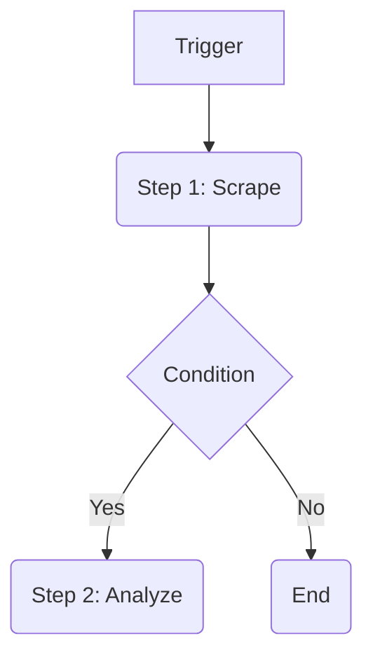

# Documentation Guide - Soothly AI

> **Philosophy:** Documentation is not an afterthought; it is the **Source of Truth**. In an AI-driven project, documentation is the prompt for the next developer (human or AI).

---

## 1. The Knowledge Graph (Mandatory References)

Before documenting or building, you must know where the truth lives.

| Domain             | Source of Truth                                                                                                 |
| :----------------- | :-------------------------------------------------------------------------------------------------------------- |
| **Business Logic** | [`agents-ecosystem/SKILL.md`](../agents-ecosystem/SKILL.md)                                                     |
| **Pricing/Limits** | [`backend-design/resources/pricing-strategy.md`](../backend-design/resources/pricing-strategy.md)               |
| **Visual Design**  | [`brand-identity/resources/design-tokens.json`](../brand-identity/resources/design-tokens.json)                 |
| **Copy/Voice**     | [`brand-identity/resources/voice-tone.md`](../brand-identity/resources/voice-tone.md)                           |
| **Connections**    | [`backend-design/resources/connection-architecture.md`](../backend-design/resources/connection-architecture.md) |

**Hierarchy of Truth:**

1. **Resource Files** (The Definition)
2. **Skill READMEs** (The Guidelines)
3. **Code Comments** (The Implementation Context)

---

## 2. Backend Documentation Standards

### A. Agent Documentation (CRITICAL)

Every Agent in `src/agents/{AgentName}` **MUST** have a `README.md` that strictly follows this template.

#### 0. Capability Map (Mandatory)

Every agent documentation MUST start with a "Capability Map" table defining its Event Contract:
| Event Input | Action Taken | Event Output |
| :--- | :--- | :--- |
| `scout.requested` | Scrapes URL, summarizes text | `scout.completed` |

#### 1. Product Context (The "Why")

| Feature          | Description                                                 |
| :--------------- | :---------------------------------------------------------- |
| **Role**         | [e.g. "The Lead Hunter"]                                    |
| **User Value**   | [e.g. "Automates 20 hours of manual prospecting per week."] |
| **Value Metric** | [e.g.`leads_generated` (Count)]                             |
| **Autonomy**     | [e.g. Manual, Smart, Auto]                                  |

**Status Quo vs. Agent Solution:**
_(Copy from `agents-ecosystem.md`)_

| Pain (Before)       | Solution (After)    |
| :------------------ | :------------------ |
| [Manual pain point] | [Automated delight] |

#### 2. Technical Architecture (The Workflow)

**Trigger:** `[Event Name]` (e.g., `campaign.started`)

**Workflow Loop (Inngest Steps):**

1. **[Step Name]**: [Description of action].
2. **[Step Name]**: [Description of action].
3. **[Step Name]**: [Description of action].

**User Intervention Points (HITL):**

- **Approval**: [e.g. "User must approve Tweet before posting"]
- **Input**: [e.g. "User must select tone if confidence < 70%"]

**Diagram:**



#### 3. Interface Definitions

**Input Schema (`zod`):**

```typescript
{
  campaignId: string; // UUID
  keywords: string[];
  model?: string; // Default: 'gemini-3-flash'
}
```

**Output Schema:**

```typescript
{
  results: Array<{ email: string; score: number }>;
  metadata: {
    processingTime: number;
  }
}
```

**Tools Used:**

- **Internal**: `db.insertLead`, `slack.notify`
- **External**: `Apify (Google Scraper)`, `OpenAI (GPT-4o)`

#### 4. Prompt Engineering Strategy

- **Strategy**: [e.g. "Chain-of-Thought with 3 distinct prompts"]
- **Prompt Files**:
  - `prompts/research.ts`: Analyzes initial keywords.
  - `prompts/drafting.ts`: Generates content based on research.

#### 5. External Dependencies & Costs

- **Service**: [e.g. "Apify"] - Cost: [$X/1k runs]
- **Service**: [e.g. "OpenAI"] - Cost: [$X/1k tokens]

### B. Inngest Functions (Durable Workflows)

Every function in `src/inngest/functions` **MUST** explain its flow and resiliency strategy.

```typescript
/**
 * Function: [Name, e.g. "Generate Campaign Report"]
 * Trigger: [Event, e.g. 'app/campaign.ended']
 *
 * Flow:
 * 1. [Step Name]: [Action] (e.g. "Fetch Stats from DB")
 * 2. [Step Name]: [Action] (e.g. "AI Analysis via GPT-4")
 * 3. [Step Name]: [Action] (e.g. "Save to 'reports' table")
 *
 * Resiliency:
 * - Retries: [e.g. "3x on AI failure"]
 * - Idempotency: [e.g. "Checks 'report_id' before running"]
 */
export default inngest.createFunction(...)
```

### C. Database Migrations

Every `.sql` file **MUST** include a `Risk Analysis` and `Performance` justification.

```sql
/*
  Migration: [Name]
  Purpose: [Business reason, e.g. "Add usage tracking"]

  Risk Analysis:
  - Locks: [e.g. "Creates index concurrently - no downtime"]
  - Data Loss: [e.g. "Safe - new column is nullable"]

  Performance:
  - Indexing: [e.g. "Index on 'org_id' for dashboard filtering"]

  Security:
  - RLS: [e.g. "Users can only see their own rows"]
*/
```

---

## 3. Frontend & Brand Documentation

### A. UI Components

For complex components, document the **Interaction Model** and **State Architecture**.

```typescript
/**
 * Component: [Name]
 *
 * Interaction Model:
 * - [User Action] -> [System Response]
 * - [User Action] -> [System Response]
 *
 * State Architecture:
 * - `localState`: [Description]
 * - `serverState` (React Query): [Description]
 * - `urlState` (Params): [Description]
 */
export function ComplexWidget(...) { ... }
```

### B. Internationalization (i18n)

**Sync or Sink**: `english.json` is the Source of Truth.
**Naming Convention**: `domain.entity.action` or `domain.component.element`.

```json
{
  "billing": {
    "pricing_card": {
      "cta_button": "Upgrade Now",
      "limit_warning": "Using {{count}} of {{limit}} credits"
    },
    "invoice": {
      "status_paid": "Paid on {{date}}"
    }
  }
}
```

---

## 4. AI Context (`llms.txt`)

The `llms.txt` file (or equivalent system prompt) **MUST** define the "AI Manifesto" for this project.

**Template:**

```markdown
# Soothly AI - AI Context

## 1. The Mission

We are building an "Autonomous Revenue Platform", not a CRUD app.
Every feature must reduce user friction ("Soothly AI").

## 2. The Stack

- **Framework**: Next.js 16 (App Router)
- **DB**: Supabase (RLS is Mandatory)
- **Orchestration**: Inngest (Durable Workflows)
- **Styling**: Tailwind v4 (Obsidian/Violet theme)

## 3. Critical Constraints

- **No Public Pages**: Only Login/Signup.
- **No Mock Data**: Use defined schemas.
- **Strict Checks**: Zod validation on ALL inputs.

## 4. Knowledge Graph

- Agents: `agents-ecosystem/SKILL.md`
- Pricing: `backend-design/resources/pricing-strategy.md`
```

---

## 5. Documentation Checklist

- [ ] **Agents**: Detailed README (Product + Tech + Prompts)?
- [ ] **Inngest**: Flow & Resiliency documented?
- [ ] **SQL**: Risk Analysis & Performance justification included?
- [ ] **UI**: State Architecture for complex components?
- [ ] **i18n**: Keys are structured and safe?
- [ ] **AI**: Does `llms.txt` reflect the latest architecture?
