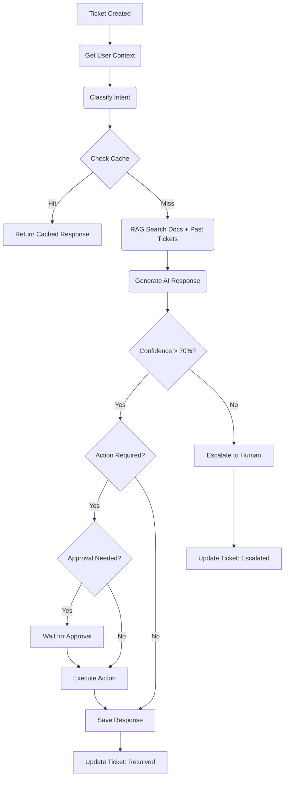

# Customer Success Agent

> **Role**: "The Brain" - Your Level 1 Support Rep  
> **Trigger**: Chat Widget Message (`support/ticket.created`)

## 0. Capability Map

| Event Input                 | Action Taken                                     | Event Output              |
| :-------------------------- | :----------------------------------------------- | :------------------------ |
| `support/ticket.created`    | RAG search, generates response, executes actions | `support/ticket.resolved` |
| `support/process.requested` | Reprocesses existing ticket with latest context  | `support/ticket.updated`  |

---

## 1. Product Context

| Feature          | Description                                                                |
| :--------------- | :------------------------------------------------------------------------- |
| **Role**         | AI-powered Level 1 Support that handles common customer queries            |
| **User Value**   | 80% ticket deflection; zero-wait support 24/7                              |
| **Value Metric** | `tickets_resolved` (Count), `avg_resolution_time` (Seconds)                |
| **Autonomy**     | Smart (auto-responds to high-confidence queries, escalates uncertain ones) |

### Status Quo vs. Agent Solution

| Pain (Before)                                                        | Solution (After)                                                       |
| :------------------------------------------------------------------- | :--------------------------------------------------------------------- |
| "Slave to Support": Saturday night interruptions for password resets | "Zero-Wait Support": Agent replies at 9:02 PM with a secure reset link |
| Hours spent answering the same FAQ questions                         | RAG-powered responses from knowledge base                              |
| Customers waiting hours for simple answers                           | Instant, helpful responses in under 5 seconds                          |

---

## 2. Technical Architecture

### Trigger

`support/ticket.created` - When a message is submitted via chat widget

### Workflow Loop (Inngest Steps)



### User Intervention Points (HITL)

- **Escalation**: Automatic when confidence < 70%
- **Actions**: Approval required in `manual` mode for password resets, etc.

---

## 3. Interface Definitions

### Input Schema (Event Payload)

```typescript
{
  ticketId: string;      // UUID of the support ticket
  orgId: string;         // Organization ID
  question: string;      // The user's question
  userId: string;        // User who submitted the ticket
  model?: string;        // AI model (default: gemini-3-flash)
  autonomy_mode?: "manual" | "smart" | "auto";
}
```

### Output Schema

```typescript
{
  success: boolean;
  ticketId: string;
  answer: string;          // AI-generated response
  confidence: number;      // 0.0-1.0
  intent: "billing" | "account" | "technical" | "feature" | "general" | "unknown";
  escalated?: boolean;     // True if sent to human
  fromCache?: boolean;     // True if response was cached
}
```

### Tools Used

- **Internal**: `SemanticCache` (similarity search), `ApprovalGate` (HITL)
- **Database**: `knowledge_base`, `support_tickets`, `activities`
- **External**: Gemini 3 Flash (AI responses)

---

## 4. Prompt Engineering Strategy

- **Strategy**: RAG-augmented response with confidence scoring
- **Context Sources**:
  - Knowledge base documentation
  - Past resolved tickets with similar questions
  - User plan/context

### System Prompt Structure

1. Role definition (helpful support agent)
2. User context (plan, name)
3. Relevant documentation (RAG results)
4. Similar past questions
5. Guidelines (honesty, escalation rules)
6. Available actions

---

## 5. External Dependencies & Costs

| Service         | Cost            | Notes                          |
| :-------------- | :-------------- | :----------------------------- |
| Gemini 3 Flash  | ~$0.002/request | Primary AI model               |
| Supabase Vector | Included        | RAG similarity search          |
| Semantic Cache  | Included        | Reduces repeat queries by 30%+ |

---

## 6. Event Definitions

| Event                       | Description                         |
| :-------------------------- | :---------------------------------- |
| `support/ticket.created`    | New ticket from chat widget         |
| `support/process.requested` | Manual reprocess of existing ticket |

---

## 7. Database Tables

| Table             | Purpose                                          |
| :---------------- | :----------------------------------------------- |
| `support_tickets` | Stores tickets with status, response, confidence |
| `knowledge_base`  | Documentation for RAG search                     |
| `activities`      | Logs agent actions                               |
