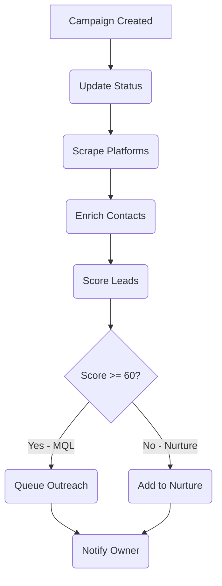

# Lead Generation Agent

## 0. Capability Map

| Event Input                | Action Taken                                  | Event Output               |
| :------------------------- | :-------------------------------------------- | :------------------------- |
| `leads/campaign.created`   | Scrapes platforms, scores leads, saves to CRM | `leads/campaign.completed` |
| `leads/enrich.requested`   | Enriches contacts via LinkedIn/Hunter         | `leads/enrich.completed`   |
| `leads/outreach.scheduled` | Sends personalized outreach emails            | `leads/outreach.sent`      |

---

## 1. Product Context (The "Why")

| Feature          | Description                                                   |
| :--------------- | :------------------------------------------------------------ |
| **Role**         | The Hunter - Your Outbound Sales Rep (SDR)                    |
| **User Value**   | Automates 20+ hours of manual prospecting per week.           |
| **Value Metric** | `leads_generated` (Count), `mql_conversion_rate` (Percentage) |

**Status Quo vs. Agent Solution:**

| Pain (Before)                                                            | Solution (After)                                                                                      |
| :----------------------------------------------------------------------- | :---------------------------------------------------------------------------------------------------- |
| "Admin Hell": Buy shady email list (half bounce), copy/paste into Gmail. | Tell Agent "Find Marketing Directors in NY." It finds 50 real humans, verifies emails, pushes to CRM. |
| Hours spent researching companies manually, often missing ideal targets. | AI scores leads against ICP, prioritizes MQLs, provides outreach angles automatically.                |

---

## 2. Technical Architecture (The Workflow)

**Trigger:** `leads/campaign.created` → Inngest Job (`leads-campaign-created`)

**Workflow Loop (Inngest Steps):**

1. **Update Status**: Mark campaign as `in_progress`.
2. **Scrape Platforms**: Query B2B databases (Apollo, LinkedIn) for prospects.
3. **Enrich Contacts**: Verify emails, gather company data.
4. **Score Leads**: Apply ICP fit scoring (0-100) with qualification tiers.
5. **Save Leads**: Store to `lead_contacts` and `contacts` tables.
6. **Queue Outreach**: Generate personalized email sequences.
7. **Notify**: Send completion notification to org owner.

**Diagram:**



---

## 3. Interface Definitions

**Input Schema (`zod`):**

```typescript
{
  campaignId: string;   // UUID - Campaign configuration
  orgId: string;        // UUID - Organization context
  icpConfig: {
    titles: string[];           // e.g. ["VP Marketing", "CMO"]
    industries: string[];       // e.g. ["SaaS", "Fintech"]
    companySizeMin: number;     // e.g. 50
    companySizeMax: number;     // e.g. 500
    locations?: string[];       // e.g. ["New York", "California"]
  }
}
```

**Output Schema:**

```typescript
{
  success: boolean;
  campaignId: string;
  leadsFound: number;
  leadsQualified: number;
  breakdown: {
    mql: number; // Score 80-100
    nurture: number; // Score 60-79
    low: number; // Score 40-59
    disqualified: number; // Score 0-39
  }
}
```

**Tools Used:**

- **Internal**: `db.insertLead`, `db.insertContact`, `notifyAgentCompletion`
- **External**: `Apollo API` (Company data), `Hunter.io` (Email verification), `OpenAI` (Scoring)

---

## 4. Prompt Engineering Strategy

- **Strategy**: Structured scoring with explicit rubric and JSON output
- **Prompt Files**:
  - `src/agents/prompts/lead_gen.ts`: Complete system prompt with ICP scoring logic
  - `src/agents/lead_gen/LeadGenAgent.ts`: `buildScoringPrompt()` method

**Scoring Rubric:**

| Factor             | Weight | Criteria                                              |
| :----------------- | :----- | :---------------------------------------------------- |
| Title Match        | 30%    | C-Level=100%, VP/Director=85%, Manager=60%, IC=30%    |
| Company Size       | 25%    | Perfect match=100%, Adjacent=70%, Mismatch=30%        |
| Industry Fit       | 25%    | Exact=100%, Related=70%, Neutral=40%, Excluded=0%     |
| Engagement Signals | 20%    | Corporate email=+20, LinkedIn active=+10, Trigger=+15 |

**Qualification Tiers:**

- **80-100**: MQL (Immediate outreach)
- **60-79**: Nurture (Warming sequence)
- **40-59**: Low Priority (Backlog)
- **0-39**: Unqualified (Do not pursue)

---

## 5. External Dependencies & Costs

| Service      | Purpose            | Cost Estimate  |
| :----------- | :----------------- | :------------- |
| Apollo API   | Company enrichment | ~$0.01/company |
| Hunter.io    | Email verification | ~$0.01/email   |
| OpenAI GPT-4 | Lead scoring       | ~$0.01/lead    |
| Apify        | LinkedIn scraping  | ~$0.05/profile |
