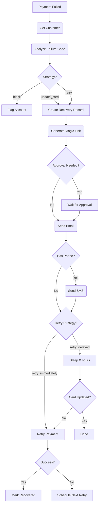

# Revenue Recovery Agent

> **Role**: "The Defender" - Your Automated Collections Team  
> **Trigger**: Stripe Webhook (`invoice.payment_failed`)

## 0. Capability Map

| Event Input               | Action Taken                                     | Event Output                                              |
| :------------------------ | :----------------------------------------------- | :-------------------------------------------------------- |
| `recovery/payment.failed` | Analyzes failure, sends magic link, queues retry | `recovery/attempt.started`                                |
| `recovery/payment.retry`  | Retries Stripe payment via API                   | `recovery/payment.succeeded` or `recovery/payment.failed` |
| `recovery/card.updated`   | Customer updated card, triggers retry            | `recovery/payment.succeeded`                              |

---

## 1. Product Context

| Feature          | Description                                                       |
| :--------------- | :---------------------------------------------------------------- |
| **Role**         | Automated recovery of failed payments to reduce involuntary churn |
| **User Value**   | Recovers 15-20% of failed payments automatically                  |
| **Value Metric** | `payments_recovered` (Count), `revenue_saved` (Amount)            |
| **Autonomy**     | Smart (auto-sends recovery emails, escalates blocked cards)       |

### Status Quo vs. Agent Solution

| Pain (Before)                                                    | Solution (After)                                                                                    |
| :--------------------------------------------------------------- | :-------------------------------------------------------------------------------------------------- |
| Card expires → payment fails → account cancels → customer churns | Payment fails at 2 AM → Agent texts at 9 AM with magic link → customer taps → FaceID → card updated |
| Lost loyal customers over a piece of plastic                     | Frictionless 10-second card update saves the subscription                                           |

---

## 2. Technical Architecture

### Trigger

`recovery/payment.failed` - Stripe webhook when `invoice.payment_failed`

### Workflow Loop (Inngest Steps)



### Recovery Strategies by Failure Code

| Failure Code                | Strategy          | Delay | Max Retries |
| :-------------------------- | :---------------- | :---- | :---------- |
| `generic_decline`           | retry_delayed     | 24h   | 3           |
| `insufficient_funds`        | retry_delayed     | 72h   | 2           |
| `expired_card`              | update_card       | -     | 0           |
| `incorrect_cvc`             | update_card       | -     | 0           |
| `processing_error`          | retry_immediately | -     | 3           |
| `lost_card` / `stolen_card` | block             | -     | 0           |

---

## 3. Interface Definitions

### Input Schema (Event Payload)

```typescript
{
  invoiceId: string;       // Stripe invoice ID
  customerId: string;      // Stripe customer ID
  failureCode: FailureCode;
  amount: number;
  orgId: string;
  currency?: string;       // Default: "USD"
  model?: string;          // AI model (not used in this agent)
  autonomy_mode?: "manual" | "smart" | "auto";
}
```

### Output Schema

```typescript
{
  success: boolean;
  invoiceId: string;
  recoveryId?: string;
  strategy: RecoveryStrategy;
  notificationsSent: ("email" | "sms")[];
}
```

---

## 4. Database Tables

| Table                | Purpose                                         |
| :------------------- | :---------------------------------------------- |
| `payment_recoveries` | Recovery attempts with status, amount, strategy |
| `activities`         | Logs agent actions                              |
| `users`              | Customer details, payment status                |

---

## 5. Event Definitions

| Event                     | Description                          |
| :------------------------ | :----------------------------------- |
| `recovery/payment.failed` | Stripe payment failure webhook       |
| `recovery/payment.retry`  | Trigger payment retry                |
| `recovery/card.updated`   | Customer updated card via magic link |

---

## 6. Costs

| Resource     | Cost           | Notes           |
| :----------- | :------------- | :-------------- |
| Email (SES)  | ~$0.0001/email | Recovery emails |
| SMS (Twilio) | ~$0.0075/SMS   | Optional SMS    |
| Stripe Retry | Free           | API call only   |
