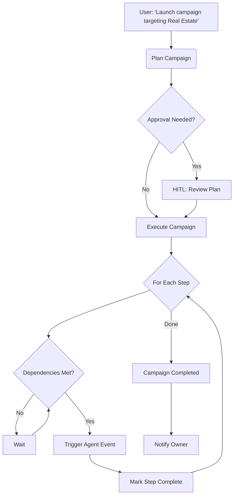

# Superagent (Meta-Orchestrator)

> **Role**: "The Manager" - Meta-Orchestrator  
> **Access**: Yearly Plan Exclusive  
> **Capability**: Coordinates multiple agents via `step.invoke`

## 0. Capability Map

| Event Input                   | Action Taken                                 | Event Output                    |
| :---------------------------- | :------------------------------------------- | :------------------------------ |
| `superagent/campaign.plan`    | Decomposes goal into agent steps, saves plan | `superagent/campaign.planned`   |
| `superagent/campaign.execute` | Dispatches agents sequentially/parallel      | `superagent/campaign.completed` |
| `superagent/campaign.status`  | Returns current progress                     | `superagent/status.returned`    |
| `superagent/campaign.cancel`  | Cancels running campaign                     | `superagent/campaign.cancelled` |

---

## 1. Product Context

| Feature          | Description                                              |
| :--------------- | :------------------------------------------------------- |
| **Role**         | Orchestrates multi-agent campaigns from a single command |
| **User Value**   | Give one order; the whole business moves                 |
| **Value Metric** | `campaigns_completed`, `agents_coordinated`              |
| **Autonomy**     | Smart (requires approval for campaign execution)         |

### Status Quo vs. Agent Solution

| Pain (Before)                              | Solution (After)                                            |
| :----------------------------------------- | :---------------------------------------------------------- |
| Tell 8 agents what to do 8 different times | Say "Get me more Yoga sales" → Full coordinated campaign    |
| Manual micro-management of each agent      | One command triggers Intel → Content → Leads → Partnerships |

---

## 2. Technical Architecture

### Trigger

`superagent/campaign.plan` - User initiates a campaign

### Campaign Flow



### Pre-Built Campaign Templates

| Type                   | Name                 | Steps                                |
| :--------------------- | :------------------- | :----------------------------------- |
| `niche_takeover`       | Niche Takeover       | Intel → SEO → Lead Gen → Partnership |
| `content_blitz`        | Content Blitz        | Intel Gaps → SEO Series              |
| `outbound_campaign`    | Outbound Sales       | Lead Scrape → Enrich → Proposals     |
| `competitive_response` | Competitive Response | Deep Analyze → Counter Content       |
| `custom`               | Custom               | AI-planned from objective            |

---

## 3. Interface Definitions

### Input Schema (Event Payload)

```typescript
{
  type: "niche_takeover" | "content_blitz" | "outbound_campaign" | "competitive_response" | "custom";
  objective: string;        // Natural language goal
  inputs: {
    targetNiche?: string;
    competitorUrl?: string;
    targetTitle?: string;
    targetIndustry?: string;
    // ... varies by type
  };
  orgId: string;
  model?: string;
  autonomy_mode?: "manual" | "smart" | "auto";
}
```

### Output Schema

```typescript
{
  success: boolean;
  campaignId: string;
  status: "planning" | "executing" | "completed" | "cancelled";
  stepsCompleted: number;
}
```

---

## 4. Step Execution

Steps execute respecting dependencies:

```typescript
// Example: Niche Takeover
[
  { id: "step_0", agentType: "competitor_intel", dependsOn: [] }, // Runs first
  { id: "step_1", agentType: "seo", dependsOn: ["step_0"] }, // Waits for step_0
  { id: "step_2", agentType: "lead_gen", dependsOn: [] }, // Runs in parallel
  { id: "step_3", agentType: "partnership", dependsOn: [] }, // Runs in parallel
];
```

---

## 5. Database Tables

| Table                  | Purpose                                    |
| :--------------------- | :----------------------------------------- |
| `superagent_campaigns` | Campaign definitions with steps and status |
| `activities`           | Logs agent actions                         |

---

## 6. Event Definitions

| Event                         | Description                |
| :---------------------------- | :------------------------- |
| `superagent/campaign.plan`    | Create and plan a campaign |
| `superagent/campaign.execute` | Execute a planned campaign |
| `superagent/campaign.status`  | Check campaign progress    |
| `superagent/campaign.cancel`  | Cancel a running campaign  |

---

## 7. Availability

**Yearly Plan Exclusive** - This agent is only available to users on the yearly subscription plan.
