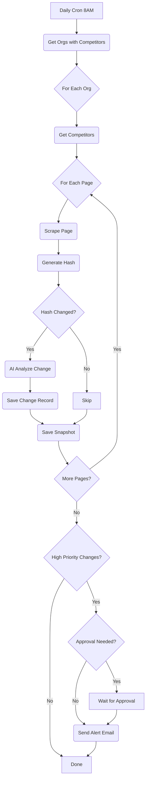

# Competitor Intel Agent

> **Role**: "The Spy" - Your Market Strategist  
> **Trigger**: Daily Cron (`0 8 * * *` - 8 AM)

---

## 1. Product Context

| Feature          | Description                                                           |
| :--------------- | :-------------------------------------------------------------------- |
| **Role**         | Monitors competitor websites for price, feature, and strategy changes |
| **User Value**   | Perfect market awareness, never be blindsided                         |
| **Value Metric** | `changes_detected`, `alerts_sent`                                     |
| **Autonomy**     | Smart (auto-scans daily, approval for sending alerts in manual mode)  |

### Status Quo vs. Agent Solution

| Pain (Before)                                            | Solution (After)                        |
| :------------------------------------------------------- | :-------------------------------------- |
| Competitor drops price 50%, you don't notice for a month | Agent checks daily, alerts within hours |
| Manual weekly competitor reviews                         | Automated daily scans with AI analysis  |

---

## 2. Technical Architecture

### Trigger

- **Daily Cron**: `0 8 * * *` (8 AM)
- **Manual**: `intel/competitor.check` event

### Workflow Loop (Inngest Steps)



### Change Classification

| Change Type       | Priority | Example                          |
| :---------------- | :------- | :------------------------------- |
| `price_change`    | Critical | "Price dropped from $99 to $49"  |
| `new_feature`     | High     | "Introducing AI-powered reports" |
| `feature_removed` | High     | "Free tier removed"              |
| `headline_change` | Medium   | "Main value prop updated"        |
| `content_update`  | Low      | "Minor text changes"             |

---

## 3. Interface Definitions

### Input Schema (Event Payload)

```typescript
{
  orgId: string;
  triggeredAt?: string;
  model?: string;
  autonomy_mode?: "manual" | "smart" | "auto";
}
```

### Output Schema

```typescript
{
  success: boolean;
  competitorsScanned: number;
  changesDetected: number;
  alertsSent: number;
}
```

---

## 4. Database Tables

| Table                  | Purpose                               |
| :--------------------- | :------------------------------------ |
| `competitors`          | Configured competitors to monitor     |
| `competitor_snapshots` | Historical page snapshots with hashes |
| `competitor_changes`   | Detected changes with AI analysis     |
| `activities`           | Logs agent actions                    |

---

## 5. Event Definitions

| Event                    | Description                   |
| :----------------------- | :---------------------------- |
| `intel/scan.daily`       | Trigger daily scan for an org |
| `intel/competitor.check` | Check a specific competitor   |
| `intel/competitor.add`   | Add new competitor to monitor |

---

## 6. Costs

| Resource       | Cost             | Notes                    |
| :------------- | :--------------- | :----------------------- |
| Gemini 3 Flash | ~$0.001/analysis | AI change classification |
| HTTP Fetch     | Free             | Page scraping (basic)    |
| Email (SES)    | ~$0.0001/alert   | Alert notifications      |
