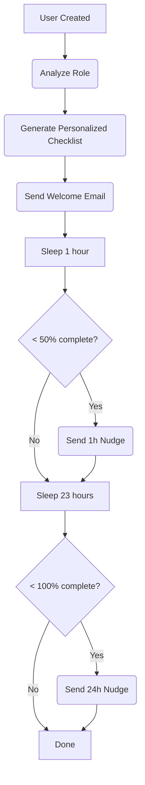

# Onboarding Agent

> **Role**: "The Guide" - Your Implementation Specialist  
> **Trigger**: Supabase Auth Hook (`auth.user.created`)

---

## 1. Product Context

| Feature          | Description                                         |
| :--------------- | :-------------------------------------------------- |
| **Role**         | Guides new users through personalized setup         |
| **User Value**   | Reduced early churn, faster Time-To-Value           |
| **Value Metric** | `onboarding_completion_rate`, `time_to_first_value` |
| **Autonomy**     | Auto (sends scheduled nudges automatically)         |

### Status Quo vs. Agent Solution

| Pain (Before)                                    | Solution (After)                                                        |
| :----------------------------------------------- | :---------------------------------------------------------------------- |
| User signs up, gets confused, quits after 3 days | Agent sees they haven't uploaded logo, sends helpful email 1 hour later |
| "Silent Churn" - never knew they were stuck      | Active monitoring with timely interventions                             |

---

## 2. Technical Architecture

### Trigger

`onboarding/user.created` - Supabase Auth Hook on signup

### Workflow Loop (Inngest Steps)



### Personalization by Role

| Role      | Included Tasks               | Excluded Tasks |
| :-------- | :--------------------------- | :------------- |
| Developer | API Keys, Connect Stripe     | Invite Team    |
| Marketer  | Create Campaign, Invite Team | API Keys       |
| Founder   | All tasks                    | None           |

---

## 3. Interface Definitions

### Input Schema (Event Payload)

```typescript
{
  userId: string;
  email: string;
  role?: "developer" | "marketer" | "designer" | "founder" | "sales" | "other";
  orgId: string;
  metadata?: {
    job_title?: string;
    company?: string;
  };
}
```

### Output Schema

```typescript
{
  success: boolean;
  userId: string;
  role: UserRole;
  tasksCreated: number;
}
```

---

## 4. Nudge Schedule

| Timing    | Type      | Condition       |
| :-------- | :-------- | :-------------- |
| Immediate | Welcome   | Always          |
| 1 hour    | Quick Win | < 50% complete  |
| 24 hours  | Progress  | < 100% complete |
| 7 days    | Final     | < 100% complete |

---

## 5. Database Tables

| Table              | Purpose                                     |
| :----------------- | :------------------------------------------ |
| `onboarding_tasks` | User-specific task list with status         |
| `users`            | Stores `onboarding_status`, `detected_role` |
| `activities`       | Logs agent actions                          |

---

## 6. Event Definitions

| Event                       | Description               |
| :-------------------------- | :------------------------ |
| `onboarding/user.created`   | New user signup trigger   |
| `onboarding/progress.check` | Check and update progress |
| `onboarding/task.completed` | Mark a task as done       |
