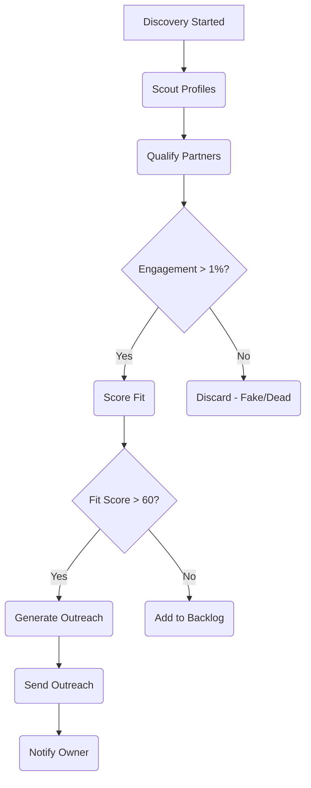

# Partnership Agent

## 1. Product Context (The "Why")

| Feature          | Description                                                              |
| :--------------- | :----------------------------------------------------------------------- |
| **Role**         | The Recruiter - Your Affiliate Manager and Scout                         |
| **User Value**   | Recruits partners who drive "Leveraged Traffic" through their audiences. |
| **Value Metric** | `partners_recruited` (Count), `affiliate_revenue` (USD)                  |

**Status Quo vs. Agent Solution:**

| Pain (Before)                                                           | Solution (After)                                                                                           |
| :---------------------------------------------------------------------- | :--------------------------------------------------------------------------------------------------------- |
| "Begging for Collabs": Spend all day DMing influencers. 99% ignore you. | Agent scans 5,000 profiles, identifies "Sarah" (Yoga Teacher), emails her: "Want 30% comms?" She says YES. |
| Can't verify if influencer has real engagement or fake followers.       | AI calculates engagement rate, detects fraud signals, recommends partnership tier automatically.           |

---

## 2. Technical Architecture (The Workflow)

**Trigger:** `partners/discovery.start` → Inngest Job (`partners-discover`)

**Workflow Loop (Inngest Steps):**

1. **Scout Profiles**: Scan social platforms for potential affiliates/influencers.
2. **Qualify Partners**: Analyze engagement rates, audience fit, brand safety.
3. **Score Fit**: Calculate partner fit score (0-100) with tier recommendation.
4. **Generate Outreach**: Create personalized partnership invitation emails.
5. **Save Partners**: Store to `partners` table with qualification data.
6. **Send Outreach**: Queue emails via integrated email provider.
7. **Notify**: Send completion notification to org owner.

**Diagram:**



---

## 3. Interface Definitions

**Input Schema (`zod`):**

```typescript
{
  partnerId?: string;   // UUID - For single partner qualification
  orgId: string;        // UUID - Organization context
  criteria: {
    platforms: string[];      // e.g. ["instagram", "tiktok", "youtube"]
    niches: string[];         // e.g. ["fitness", "wellness", "yoga"]
    followerMin: number;      // e.g. 5000
    followerMax: number;      // e.g. 500000
    minEngagementRate: number; // e.g. 1.0 (percentage)
  }
}
```

**Output Schema:**

```typescript
{
  success: boolean;
  partnersFound: number;
  partnersQualified: number;
  tierBreakdown: {
    tier_1: number; // Premium (30% commission)
    tier_2: number; // Standard (25% commission)
    tier_3: number; // Starter (20% commission)
    rejected: number;
  }
}
```

**Tools Used:**

- **Internal**: `db.insertPartner`, `sendPartnerOutreach`, `notifyAgentCompletion`
- **External**: `Apify` (Social scraping), `Hunter.io` (Email discovery), `OpenAI` (Qualification)

---

## 4. Prompt Engineering Strategy

- **Strategy**: Multi-factor evaluation with safety checks and tier recommendation
- **Prompt Files**:
  - `src/agents/prompts/partnership.ts`: Complete system prompt with engagement formulas
  - `src/agents/partnership/PartnershipAgent.ts`: `qualifyPartner()` and `sendOutreach()` methods

**Engagement Rate Formula:**

```
engagement_rate = (avg_likes + avg_comments) / followers × 100
```

**Qualification Factors:**

| Factor             | Weight | Criteria                                 |
| :----------------- | :----- | :--------------------------------------- |
| Audience Overlap   | 35%    | Demographics, interests, geography match |
| Engagement Quality | 25%    | Real humans, genuine interaction         |
| Brand Alignment    | 20%    | Values, tone, aesthetic compatibility    |
| Content Fit        | 20%    | Natural product integration potential    |

**Partnership Tiers:**

| Tier              | Commission | Requirements                              |
| :---------------- | :--------- | :---------------------------------------- |
| Tier 1 (Premium)  | 30%        | 50K+ followers, 3%+ engagement, brand fit |
| Tier 2 (Standard) | 25%        | 10K+ followers, 2%+ engagement            |
| Tier 3 (Starter)  | 20%        | 5K+ followers, verified engagement        |

---

## 5. External Dependencies & Costs

| Service      | Purpose               | Cost Estimate     |
| :----------- | :-------------------- | :---------------- |
| Apify        | Social media scraping | ~$0.05/profile    |
| Hunter.io    | Email discovery       | ~$0.01/email      |
| OpenAI GPT-4 | Partner qualification | ~$0.02/evaluation |
| SES/Sendgrid | Outreach emails       | ~$0.001/email     |
