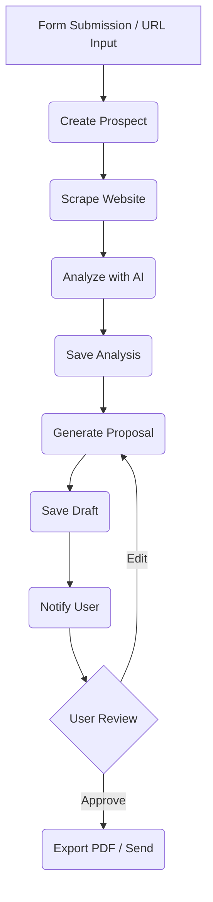

# Proposal Generator Agent

## 1. Product Context (The "Why")

| Feature          | Description                                              |
| :--------------- | :------------------------------------------------------- |
| **Role**         | The Closer - Your Deal Desk / Sales Engineer             |
| **User Value**   | Creates personalized proposals in seconds, not hours.    |
| **Value Metric** | `proposals_generated` (Count), `close_rate` (Percentage) |
| **Autonomy**     | Smart (asks for approval on high-cost actions)           |

**Status Quo vs. Agent Solution:**

| Pain (Before)                                                           | Solution (After)                                                                            |
| :---------------------------------------------------------------------- | :------------------------------------------------------------------------------------------ |
| "The Proposal Panic": Dig up old Word doc, find/replace, pray for typos | Agent reads prospect's website, understands their needs, generates custom PDF in 30 seconds |
| 2+ hours per proposal, sent 2 days late                                 | Instant context-aware proposals. Win on speed and relevance.                                |

---

## 2. Technical Architecture (The Workflow)

**Trigger:** `proposal/create.full` → Inngest Job (`proposal-create-full`)

**Workflow Loop (Inngest Steps):**

1. **Create Prospect**: Insert prospect record with status `analyzing`
2. **Scrape Website**: Multi-page scrape (Home, About, Pricing, Blog)
3. **Analyze Prospect**: AI extracts company info, pain points, value propositions
4. **Save Analysis**: Update prospect with analysis data
5. **Generate Proposal**: AI creates personalized proposal content
6. **Save Proposal**: Insert proposal with status `draft`
7. **Update Status**: Mark prospect as `proposal_ready`
8. **Log Activity**: Record agent action in activities table
9. **Notify Owner**: Send notification if preferences allow

**User Intervention Points (HITL):**

- **Approval**: User reviews and approves before sending to prospect
- **Editing**: User can modify generated content before export

**Diagram:**



---

## 3. Interface Definitions

**Input Schema (`zod`):**

```typescript
{
  prospectUrl: string;        // URL to analyze
  contactName?: string;       // Optional: Contact name
  contactEmail?: string;      // Optional: Contact email
  templateId?: string;        // Optional: Custom template
}
```

**Output Schema:**

```typescript
{
  success: boolean;
  prospectId: string;         // UUID of created prospect
  proposalId: string;         // UUID of generated proposal
  companyName: string;        // Detected company name
  content: {
    title: string;
    executiveSummary: string;
    challenge: string;
    solution: string;
    outcomes: string[];
    whyUs: string[];
    nextSteps: string;
  }
}
```

**Tools Used:**

- **Internal**: `db.insertProspect`, `db.insertProposal`, `notifyAgentCompletion`
- **External**: `Firecrawl/Apify` (Web Scraping), `OpenAI/Gemini` (Analysis & Generation)

---

## 4. Prompt Engineering Strategy

- **Strategy**: Two-stage prompting (Analysis → Generation)
- **Prompt Files**:
  - `ProposalAgent.ts`: `buildAnalysisPrompt()` - Extracts company data and pain points
  - `ProposalAgent.ts`: `buildProposalPrompt()` - Generates proposal from analysis

**Analysis Output Structure:**

- Company name, industry, size estimation
- Pain points identified from website content
- Value propositions mapped to our solutions
- Proposal angle with headline and key benefits
- Confidence score (0-1)

**Generation Output Structure:**

- Executive Summary (hook)
- Challenge validation
- Solution mapping
- Expected outcomes
- Differentiators
- Next steps CTA

---

## 5. External Dependencies & Costs

| Service      | Purpose               | Cost Estimate   |
| :----------- | :-------------------- | :-------------- |
| Firecrawl    | Website scraping      | ~$0.01/page     |
| OpenAI GPT-4 | Analysis              | ~$0.03/analysis |
| OpenAI GPT-4 | Proposal generation   | ~$0.05/proposal |
| React-PDF    | PDF export (optional) | Free            |

---

## 6. Events

| Event Name                    | Description                          |
| :---------------------------- | :----------------------------------- |
| `proposal/create.full`        | Start full proposal workflow         |
| `proposal/analyze.requested`  | Run analysis step only               |
| `proposal/generate.requested` | Generate proposal from existing data |

---

## 7. Database Tables

- **`prospects`**: Stores scraped/analyzed prospect data
- **`proposals`**: Stores generated proposal content and status
- **`activities`**: Logs agent actions for audit trail
