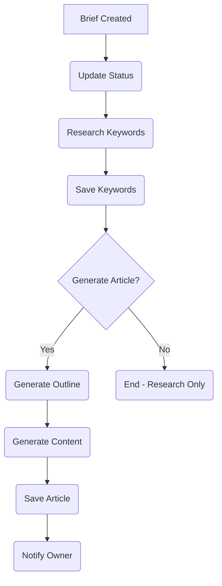

# SEO Content Agent

## 1. Product Context (The "Why")

| Feature          | Description                                                    |
| :--------------- | :------------------------------------------------------------- |
| **Role**         | The Traffic Engine - Your 24/7 Content Marketing Manager       |
| **User Value**   | Creates permanent "Owned Land" traffic assets while you sleep. |
| **Value Metric** | `articles_published` (Count), `organic_traffic` (Monthly)      |

**Status Quo vs. Agent Solution:**

| Pain (Before)                                                              | Solution (After)                                                                                                  |
| :------------------------------------------------------------------------- | :---------------------------------------------------------------------------------------------------------------- |
| "Writer's Block": Stare at blank screen for 2 hours, give up after week 3. | Agent finds high-intent keyword, writes 2,000-word expert review, publishes to blog. Wake up to 500 new visitors. |
| Manual keyword research takes hours, often picks wrong targets.            | AI analyzes search landscape, finds low-competition + high-intent keywords automatically.                         |

---

## 2. Technical Architecture (The Workflow)

**Trigger:** `content/brief.created` → Inngest Job (`content-brief-created`)

**Workflow Loop (Inngest Steps):**

1. **Update Status**: Mark brief as `in_progress`.
2. **Research Keywords**: Query AI for related keywords with volume/difficulty.
3. **Save Keywords**: Store to `keywords` table, update brief with secondary keywords.
4. **Generate Outline**: Create H2/H3 structure with key points.
5. **Generate Content**: Write full article using selected AI model.
6. **Save Article**: Store to `articles` table with metadata.
7. **Notify**: Send completion notification to org owner.

**Diagram:**



---

## 3. Interface Definitions

**Input Schema (`zod`):**

```typescript
{
  briefId: string;    // UUID - Content brief to process
  orgId: string;      // UUID - Organization context
  model?: AIModel;    // Optional - AI model (default: gemini-3-flash)
  config?: {
    brandVoice?: string;
    targetAudience?: string;
    contentGuidelines?: string[];
  }
}
```

**Output Schema:**

```typescript
{
  success: boolean;
  articleId?: string;
  title: string;
  wordCount: number;
  model: AIModel;
  keywords?: Array<{
    keyword: string;
    search_volume: number;
    keyword_difficulty: number;
  }>;
}
```

**Tools Used:**

- **Internal**: `db.insertArticle`, `db.insertKeyword`, `notifyAgentCompletion`
- **External**: `OpenAI/Gemini` (Content Generation), `Serper API` (Optional keyword data)

---

## 4. Prompt Engineering Strategy

- **Strategy**: Chain-of-Thought with 3 distinct prompts (Outline → Content → SEO Optimization)
- **Prompt Files**:
  - `src/agents/prompts/seo.ts`: Complete system prompt with workflow instructions
  - Inline prompts in `src/inngest/functions/seo.ts` for specific tasks

**Prompt Chain:**

1. **Research Prompt**: Analyze primary keyword, generate related keywords with metrics
2. **Outline Prompt**: Create structured article outline with H2/H3 hierarchy
3. **Content Prompt**: Write full article following outline and SEO best practices
4. **Optimization Prompt**: Analyze SEO score, suggest improvements, generate meta tags

---

## 5. External Dependencies & Costs

| Service      | Purpose            | Cost Estimate      |
| :----------- | :----------------- | :----------------- |
| OpenAI GPT-4 | Article generation | ~$0.03/1k tokens   |
| Gemini Flash | Fast drafts        | ~$0.00035/1k chars |
| Serper API   | Keyword data       | ~$0.001/search     |
